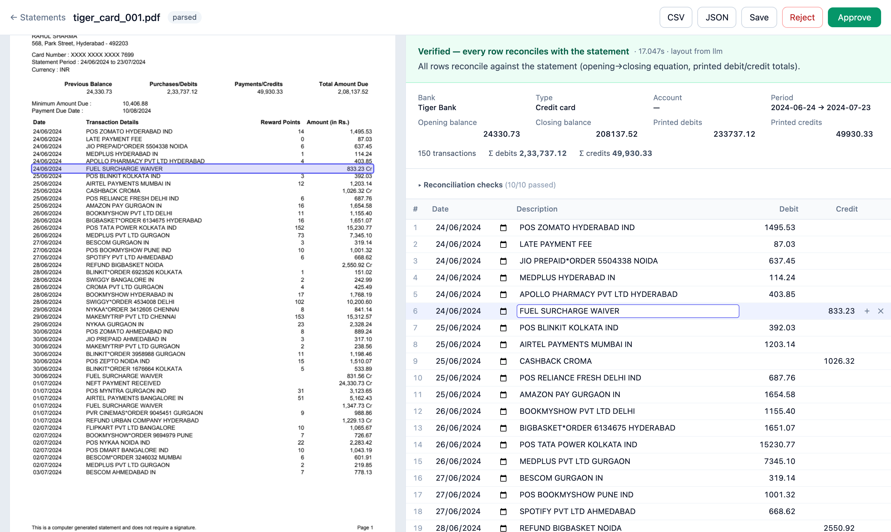

# Awesome Statement Parser

**Turn any bank or credit card statement into verified transactions — entirely on your own machine.**

PDF (including password-protected), CSV, XLS or XLSX in; a clean list of dated, signed
transactions out, with every row reconciled against the totals the bank printed. No cloud,
no API keys, no per-bank templates. A small local model ([Gemma 4](https://ai.google.dev/gemma)
via [LM Studio](https://lmstudio.ai)) reads each new layout once; plain Python does the rest.



## Why

Statement parsers usually come as one hand-written template per bank — and break the day the
bank changes its layout. Sending statements to a cloud model instead means sending your
financial history to someone else. This project does neither:

- **Universal.** No templates. A new layout is understood on the fly, then remembered.
- **Private.** Everything runs locally: text extraction, the language model, the checks, the UI.
- **Verified, not guessed.** A parse is only marked *verified* when the running balance, the
  opening and closing balances and the printed totals all agree to the paisa. Anything else
  is flagged for review — never silently passed through.

## Features

- Bank accounts and credit cards; PDF, CSV, XLS, XLSX; password-protected PDFs and spreadsheets
- Handles the awkward cases real statements throw at you: two-line headers, wrapped and
  middle-aligned narrations, Dr/Cr suffixes and columns, signed amounts, newest-first order,
  end-of-day-only balances, B/F and C/F rows, multiple card sections, long account-information
  preambles, and **tables whose header is an image** (columns are then read from the rows)
- Layouts are fingerprinted and cached — after the first statement, the same layout parses in
  well under a second with no model call
- A review UI: the document on the left (click a row to highlight it), the parsed statement on
  the right; edit, add or delete rows and the checks re-run live; approve, reject, export CSV/JSON
- CLI, Python library, JSON API, and a FastAPI router you can mount inside your own app
- A synthetic statement generator with exact ground truth, and an evaluation harness

## Quick start

**1. Install** (Python 3.11+):

```bash
git clone https://github.com/<you>/awesome-statement-parser.git
cd awesome-statement-parser
python -m venv .venv && source .venv/bin/activate
pip install -e ".[dev]"
```

**2. Run a local model.** Install [LM Studio](https://lmstudio.ai), download a Gemma 4 model
(`google/gemma-4-e4b` runs comfortably on a 16 GB Mac), load it, and start the local server
(Developer tab → Start Server, default `http://localhost:1234`).

**3. Parse.**

```bash
asp serve                       # review UI at http://127.0.0.1:8765
asp parse statement.pdf         # or straight from the command line (prompts for a password)
```

Gemma's weights are not part of this project; they are downloaded by you under Google's
[Gemma terms of use](https://ai.google.dev/gemma/terms).

## How it works

```
statement ──► LiteParse ──► words with positions ──► layout seen before? ──yes──┐
                                                         │ no                  │
                                                         ▼                     │
                                     local model: "describe this layout"       │
                                     columns · summary labels · bank or card   │
                                                         │                     │
                                                         ▼                     ▼
                                  table reader (Python, every row) ◄───────────┘
                                                         │
                                                         ▼
                              reconciliation checks ──► verified / consistent / needs review
                                                         │
                                              verified ──► layout remembered
```

1. **Extract.** [LiteParse](https://github.com/run-llama/liteparse) turns the PDF into words
   with exact positions. Spreadsheets are read directly.
2. **Understand the layout.** The model is shown a compact view of the document — the
   preamble, the table's header and first rows, the closing summary — and answers one small
   question: which column is the date, narration, debit, credit or balance; what the printed
   summary labels are; bank account or credit card. **It never copies a single transaction.**
3. **Read every row.** Python finds the columns from the whitespace between them, joins wrapped
   narrations, parses Indian and western number formats, and resolves debit/credit direction.
   If the header isn't readable text, the columns come from the rows themselves.
4. **Check everything** (below), then try cheap variations (debit/credit swapped, the other
   sign convention, columns read from the rows) and, if time allows, one repair question to
   the model that says exactly what failed.

More detail: [docs/how-it-works.md](docs/how-it-works.md).

## What "verified" means

A statement is **verified** only when the extracted rows are tied — with exact decimal
arithmetic — to numbers the bank printed independently of those rows, and nothing contradicts
them:

| Check | What it catches |
|---|---|
| Running balance, row by row, from the printed opening balance | a missing, extra, mis-signed or mis-read row — at the exact row |
| Opening + credits − debits = closing (cards: + debits − credits) | anything that changes the total |
| Σ debits, Σ credits and transaction counts vs. the printed summary | errors on statements without a balance column |
| Every amount in the table is used or explicitly a non-transaction | rows the reader skipped |
| Narrations contain words | a reference-number column read as the narration |
| Printed "Withdrawal/Debit/Dr" columns are never mapped as credit; bank vs. card agrees with the document's wording | the one mistake arithmetic cannot see: a debit/credit swap that cancels out against a wrong statement type |

Verdicts: **verified**, **consistent** (internally coherent but nothing printed to anchor it —
e.g. a CSV export with no opening balance), **needs review** (a check failed or there is
nothing to check against), **failed** (no transactions found). Nothing is ever marked
verified on the model's say-so. See [docs/how-it-works.md](docs/how-it-works.md#verification).

## Accuracy

Measured with `google/gemma-4-e4b` (4-bit) in LM Studio on an Apple M4 with 16 GB of memory.

| Test set | Statements | Verified and exactly right | Silently wrong | Time per statement |
|---|---|---|---|---|
| Synthetic, 12 layout families, perfect layout answer | 72 | 72 | 0 | < 0.3 s |
| Synthetic, simulated sloppy model (paraphrased headers, dropped fields, swapped columns) | 72 | 72 | 0 | < 0.4 s |
| Synthetic, real local model, every layout unseen | 28 | 28 | 0 | median ~16 s, max ~35 s |
| Real Indian statements (savings PDF/CSV/XLSX, 45 to 924 rows) | 6 | matched hand-written parsers row for row; a 49-page statement with an image header verified (619 rows) | 0 | 9–46 s first time; < 1 s once the layout is learned |

"Silently wrong" — verified, but not exactly right — is the number that matters, and it is 0.
A small sample of real statements is not proof of universality: please report layouts that
fail (see below). Details and how to reproduce: [docs/accuracy.md](docs/accuracy.md).

## Usage

```bash
asp parse statement.pdf --csv out.csv   # parse, print the checks, write a CSV
asp parse statement.pdf --json          # full result as JSON
asp serve --port 8765                   # review UI + API
asp layouts                             # layouts learned so far
asp synth corpus/ && asp eval corpus/   # generate synthetic statements and measure accuracy
asp inspect statement.pdf               # privacy-safe report for a statement that fails
```

As a library:

```python
from awesome_statement_parser import parse_statement, result_to_dict

result = await parse_statement(file_bytes, "statement.pdf", password=None)
result.status         # "verified" | "consistent" | "needs_review" | "failed"
result.transactions   # date, description, amount (Decimal), direction, balance, source position
result_to_dict(result)
```

Inside your own FastAPI app:

```python
from awesome_statement_parser.server import router
app.include_router(router, prefix="/statements")
```

API reference and the result format: [docs/api.md](docs/api.md).

## Configuration

Environment variables, all optional:

| Variable | Default | Meaning |
|---|---|---|
| `ASP_LLM_URL` | `http://localhost:1234/v1` | any OpenAI-compatible local server |
| `ASP_LLM_MODEL` | first loaded Gemma model | model id |
| `ASP_LLM_TIMEOUT` | `45` | seconds per model call |
| `ASP_TIME_BUDGET` | `60` | whole-parse budget; the repair question is skipped beyond it |
| `ASP_DATA_DIR` | `~/.awesome-statement-parser` | learned layouts and review jobs |
| `ASP_USE_CACHE` | `1` | `0` to always ask the model |

## Privacy

- No network calls except to the model server you configure (local by default).
- Uploaded files, page images and results stay in `ASP_DATA_DIR` on your disk.
- Passwords are used in memory only and never written anywhere.
- The UI loads Tailwind and Alpine.js from public CDNs; no statement data is sent with those requests.

**Reporting a statement that fails:** never attach a real statement to an issue. Run
`asp inspect statement.pdf` instead — it writes a report of the layout's *structure* with
every name, number and narration masked (letters become `A`, digits `9`), which is enough to
diagnose and reproduce the problem with a synthetic statement.

## Limitations

- **Scanned statements** (images without a text layer) go through LiteParse's OCR, which has
  not been evaluated here.
- **Loan and overdraft-style accounts** whose printed balance does not follow
  opening ± transactions will be flagged *needs review*, by design.
- A statement that prints neither balances nor totals cannot be verified; it lands in
  *needs review* for you to check.
- **Known upstream issue:** LiteParse can drop short text items in some tight layouts
  ([repro](scripts/liteparse_text_drop_repro.py)). A dropped amount or date is caught by the
  checks; a dropped trailing word of a narration may not be.
- Built and tested mostly on Indian banks and cards (number formats, `Dr`/`Cr` conventions);
  other regions should work but have seen less testing.

## Contributing

Bug reports with an `asp inspect` report, new synthetic layout families and fixes are all
welcome — see [CONTRIBUTING.md](CONTRIBUTING.md).

## License

[MIT](LICENSE). Built on [LiteParse](https://github.com/run-llama/liteparse) (Apache-2.0),
[FastAPI](https://fastapi.tiangolo.com), [openpyxl](https://openpyxl.readthedocs.io),
[xlrd](https://github.com/python-excel/xlrd), [msoffcrypto-tool](https://github.com/nolze/msoffcrypto-tool)
and [ReportLab](https://www.reportlab.com) (synthetic data).
